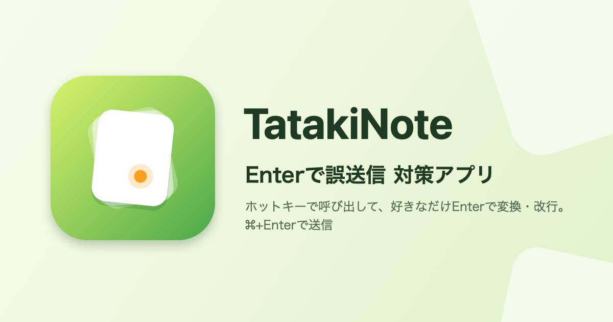

# TatakiNote

### 「Enterで送信する」対策アプリ。 ⌘+↩で送信したい。
ホットキーで呼び出して、Enter で変換確定も改行も好きなだけ。`⌘↩` で送信。

ChatGPT・Claude・Gemini などの AI チャットに送る文章(叩き台)を書くための、メニューバーに常駐する macOS アプリです。

## 改行したいだけなのに送信!! 変換確定したいだけなのに送信!!

- **変換を確定しようと Enter を押したら、書きかけの文が送られてしまった**
- **改行のつもりの Enter で、途中までの文章が送られてしまった**
- **長いプロンプトほど、誤送信が怖くて落ち着いて書けない**

AI チャットの入力欄では、Enter を押すと送信されます。日本語は変換の確定にも Enter を使うので、書いている途中で送ってしまいがちです。

## TatakiNote は Enter による誤送信を防ぎます。

入力欄に直接書かず、手元のパネルで書いてから流し込みます。

1. AI チャットの入力欄をクリックして、ホットキー `⌥⇧Space` を押します。パネルが開きます。(ホットキーは変更可能)
2. パネルで書きます。**Enter はただの改行**なので、変換の確定にも改行にも気兼ねなく使えます。
3. `⌘↩` を押すと、パネルが閉じ、元の入力欄に文章が入って送信されます。

送る前に内容を確かめたいときは、`⇧⌘↩` で入れるだけにして、自分で Enter を押して送ります。

## TatakiNote の便利なところ

- **どのアプリでも使えます。** ブラウザの AI チャットでも、Claude や ChatGPT のデスクトップアプリでも使えます。Slack や Discord など、Enter で送るほかのアプリでも同じように使えます。
- **書きかけは残ります。** `esc` でパネルを閉じても、書いた文章はパネルに残ります。
- **下書きに保存できます。** `⌘S` で書いた文章を下書きとして保存し、パネルのサイドバー(`⌘B`)からいつでも呼び戻せます。送る前の文章だけでなく、思いついたアイデアの書き留めにも使えます。パネルで `⌘E` を押してノートにすると、その書きかけは挿入・送信されず、確定のキーを押しても改行になります。送るつもりのないメモや、まだ送りたくない文章に使えます。
- **長い文章を整えやすい。** 行の入れ替え・複製、行ごとのコピー・切り取り・貼り付けなど、VSCode のような編集のショートカットが使えます。
- **入力欄を選ぶだけで開くこともできます。** 設定の「自動表示」で、選んだアプリの入力欄をクリックしたときにパネルが開くようにできます。
- **キーは変えられます。** ホットキー、確定+挿入キー(入れるだけ)、確定+送信キーは、設定で好きなキーにできます。

## 動作環境

macOS 14 以降

## 入手とインストール

1. [Releases](../../releases) から最新の `TatakiNote-<版>.zip` をダウンロードし、開いて `TatakiNote.app` を取り出します。
2. `TatakiNote.app` を「アプリケーション」フォルダに入れて開きます。
3. 初めて開くときは「インターネットからダウンロードされたアプリケーションです。開いてもよろしいですか?」と確認が出るので、「開く」を押します。TatakiNote は Apple の公証(開発元の確認)を受けています。

起動するとメニューバーに現れます。続けて「[最初にやること](#最初にやること)」に進みます。

新しい版に更新するときは、TatakiNote を終了してから「アプリケーション」フォルダの `TatakiNote.app` を置き換えます。アクセシビリティの許可はそのまま引き継がれます。各版の変更点は [Releases](../../releases) に載せています。

## 最初にやること

1. **アクセシビリティを許可する。** 書いた文章を他のアプリに入れるのに要ります。初回の起動時に案内が開くので、手順に沿って許可します。詳しくは[アクセシビリティの許可](docs/features/accessibility.md)を見てください。
2. **チュートリアルで試す。** 許可すると、AI チャット風の練習用のチャットでパネルを開いて書いて送るまでを試せるチュートリアルが開きます。あとから設定の「情報」でも開けます([チュートリアル](docs/features/tutorial.md))。

## よくある質問

**入力欄に直接書くのと何が違うのですか?**
パネルの中では Enter で送信されないので、変換の確定や改行の Enter で送ってしまうことがありません。書き終えて送ると決めたときだけ、`⌘↩` で入れて送ります。

**AI チャットの設定で Enter の動きを変えればよいのでは?**
設定があるアプリもありますが、アプリごとに違い、設定の無いアプリもあります。TatakiNote なら、どのアプリでも同じキーで書けます。

**アクセシビリティの許可は何に使いますか?**
書いた文章を元のアプリの入力欄に入れること(⌘V と Enter を送ること)と、入力欄が選ばれているかを調べることに使います。

## 使い方

機能ごとの説明は[TatakiNote の使い方](docs/README.md)にまとめています。

- [チュートリアル](docs/features/tutorial.md)
- [入力パネル](docs/features/panel.md)
- [入力欄の編集ショートカット](docs/features/text-editing.md)
- [下書きと履歴](docs/features/drafts-and-history.md)
- [書いた文章を挿入する・送信する](docs/features/insert-and-send.md)
- [入力欄を選んだらパネルを自動で出す](docs/features/auto-show.md)
- [設定ウィンドウ](docs/features/settings.md)
